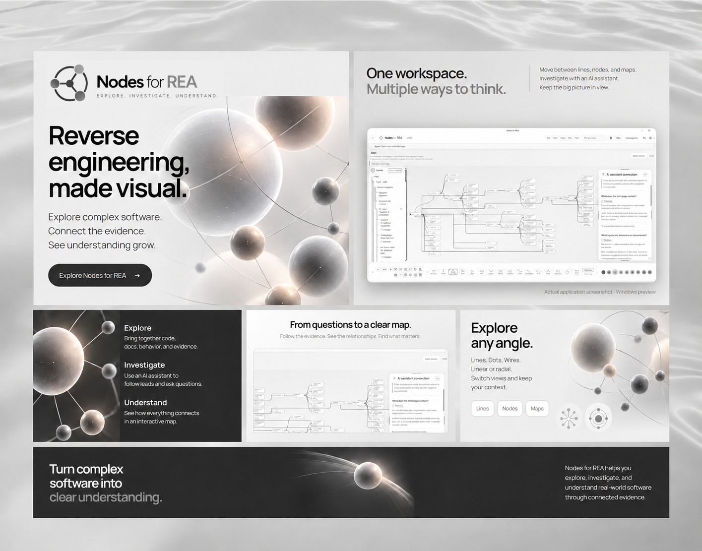
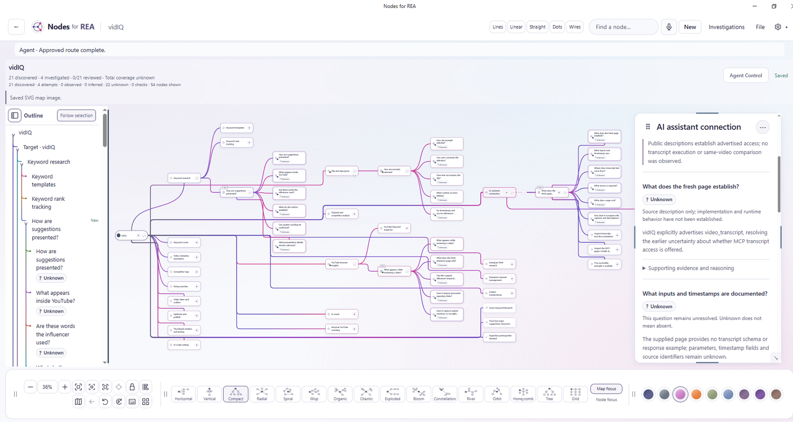

# Nodes for REA

A desktop mind map for exploring how software works. Follow a question, inspect
its evidence, and keep connected findings in a saved investigation.

[Install](#install-and-open) · [Release notes](https://github.com/aiuci/nodes-for-rea/releases) · [Project website](https://gorgeous.systems/nodes-for-rea/) · [Contribute](CONTRIBUTING.md)

[](https://gorgeous.systems/#products)

*Explore. Investigate. Understand. Promotional composition based on the official site artwork; unmodified application screenshots follow below. [Explore Gorgeous Systems](https://gorgeous.systems/#products).*

## Inside the application

<a href="docs/images/nodes-workspace-light.png">
  <picture>
    <source media="(prefers-color-scheme: dark)" srcset="docs/images/nodes-workspace-dark.png">
    <source media="(prefers-color-scheme: light)" srcset="docs/images/nodes-workspace-light.png">
    
  </picture>
</a>

*Actual application screenshots from [Gorgeous Systems](https://gorgeous.systems/nodes-for-rea/), showing the vidIQ investigation. Public descriptions and unverified runtime behavior remain distinct. [Light screenshot](docs/images/nodes-workspace-light.png) · [Dark screenshot](docs/images/nodes-workspace-dark.png).*

## Keep the investigation. See the connections.

- **Find your way through.** Explore a connected mind map or use the outline to
  return to a question. Choose a layout and theme that suit how you think.
- **Guide the next step.** Use Agent Control to plan and approve investigation
  directions with your connected AI agent.
- **Read what supports a finding.** Open a node's evidence and reasoning while
  keeping the wider map in view. Unresolved questions can remain Unknown.
- **Pick up where you left off.** Save a `.reanodes` document and reopen the map,
  retained findings and partial work.

REA provides software inspection; Nodes keeps the questions and evidence together.
Explore software you have permission to investigate, and check AI conclusions
against their supporting sources.

**Windows x64 preview.** Start with a gentle, optional four-step tour. You can
pause it, resume later, or open it from Settings → Help → Quick tour.

## Install and open

Install a supported Node.js version (22.19+ in the 22.x line, 24.11+ in
the 24.x line, or 26+), then run:

```sh
npm install -g nodes-for-rea
nodes-for-rea
```

The first launch prepares Electron if needed. Leave the terminal open until
Nodes appears. Internet access is needed for installation/runtime downloads.
The installed app and dependencies use about 1.05 GB on the tested Windows host.

## Get your first saved finding

1. Choose **Guide me**, select your agent and check the example's inspection tools.
2. Start the small shipping-code example when ready. This uses your selected AI
   account and may use credits. No model request starts merely by opening the tour.
3. Read one finding and its retained supporting quotation.
4. Confirm saving, then keep exploring or try your own source.

REA inspects software; your selected agent interprets the evidence. Observed,
Inferred and Unknown describe support in the investigation. Static inspection
alone does not establish runtime behavior. Finding labels do not independently
verify semantic correctness or resolve contradictory sources.

Codex and REA are pinned npm dependencies. An agent sign-in and model access are
separate from installation. Other supported agent connections can be configured
in Settings. Native providers such as Ghidra/JDK and optional voice assets are
additional tools; the built-in JavaScript example does not require a native provider.

## Saved work and updates

Investigations, evidence, settings and profile live under:

```text
%LOCALAPPDATA%\Nodes for REA
```

Close Nodes before updating, then run the install command again. npm replaces
installed program files; your saved work remains outside them. Uninstalling the
npm package also leaves this saved work. Back it up separately. Existing ZIP and
development data are not automatically moved or merged; use document export/open
to transfer chosen investigations. Use File → Save As for transferable documents.

```sh
nodes-for-rea --help
nodes-for-rea --diagnostics
nodes-for-rea --data-dir "C:\My Nodes workspace"
```

Diagnostics contain local paths; review them before sharing. Use the same
`--data-dir` on later launches to return to that workspace.

## Preview limits

Tested on Windows 10 x64 with Node 22.22.0. The source verification includes 837
source tests, 15 installed-tour checks, genuine REA JavaScript inspection and
normal reopen/update retention. Automated AI responses were controlled fixtures;
they do not establish live model quality, account entitlement or beginner usability.
Windows 11, physical microphone and all native-provider acceptance are not claimed.

Known preview limitations include contradictory-source conclusions and some
diagnostic disclosures. Review source evidence before relying on a finding.
npm does not provide a Windows publisher certificate or guarantee warning-free
desktop execution.

## Source and contributions

The complete editable application source is in this repository and in the npm
package. See [SOURCE.md](SOURCE.md) for cloning, running, testing and repacking;
see [CONTRIBUTING.md](CONTRIBUTING.md) to propose changes.

[Latest release notes and artifacts](https://github.com/aiuci/nodes-for-rea/releases/tag/v0.3.0-preview.20261025.6).
This release uses npm installation. Earlier `.1` standalone Windows ZIP assets
remain available as an older preview. GitHub's automatic source archives are
source code, not standalone Windows installers.

## License, source and creator

Original Nodes for REA code is AGPL-3.0-only, copyright (C) 2026 Jeremy Opio.
You can use, modify and commercially redistribute it under that license; covered
redistributed derivative works and applicable modified network versions have
source-sharing obligations. The editable source is included in this repository
and the npm package; see [LICENSE](LICENSE), [NOTICE.md](NOTICE.md),
[SOURCE.md](SOURCE.md) and [THIRD-PARTY-NOTICES.md](THIRD-PARTY-NOTICES.md).

Gorgeous Systems and Nodes for REA branding identifies the official project;
see TRADEMARKS.md. Unrelated Gorgeous Systems work is not licensed by this release.
REA and all other upstream projects keep their own copyright and licenses.
REA is maintained upstream at https://github.com/morluto/rea.

Official home: https://gorgeous.systems/nodes-for-rea/
Built by Jeremy Opio / Gorgeous Systems.

